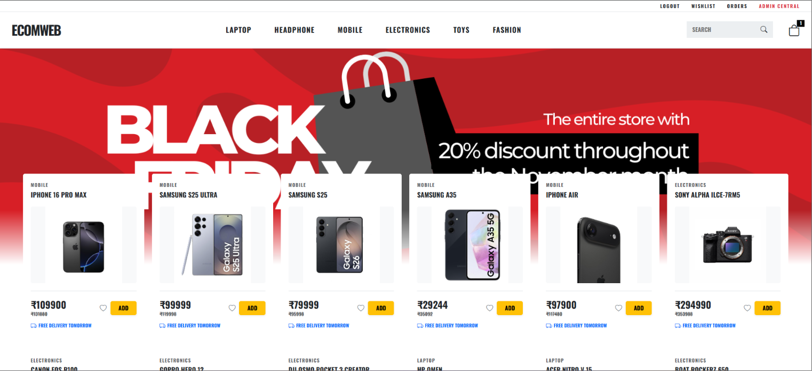
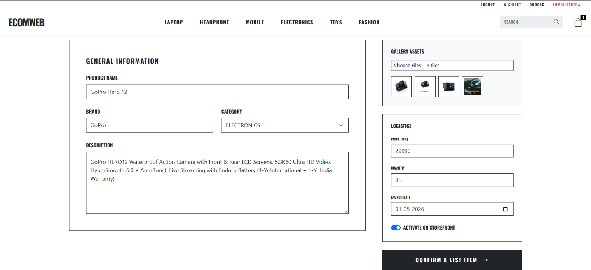
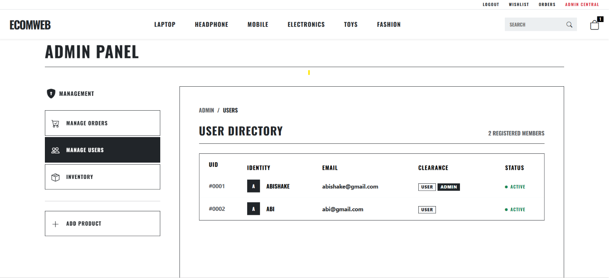
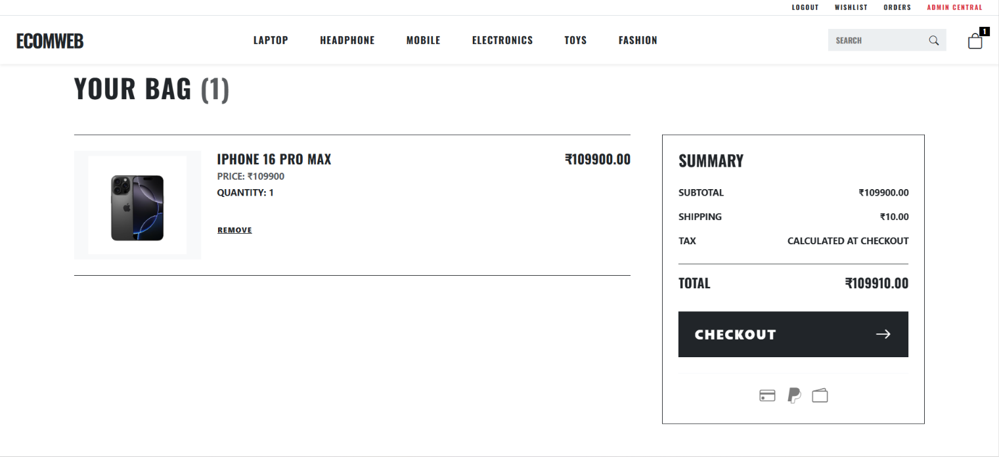
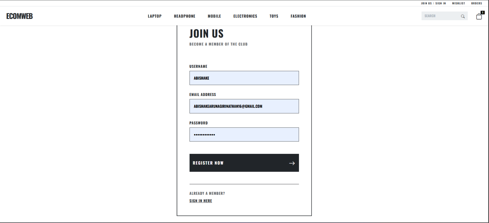
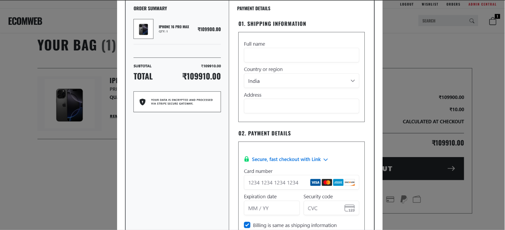

# KLYRO – Full Stack E-Commerce Application

A comprehensive e-commerce web application built with React + Vite (frontend) and Spring Boot (backend). Includes product management, user authentication with JWT, shopping cart, wishlists, order processing, and Stripe payment integration.

## Live Demo

<p align="center">
  <a href="https://ecom-web-vert.vercel.app/">
    
  </a>
  <br>
  <em><strong>Click the image above to view the live portal</strong></em>
</p>

## Overview

- **Frontend**: React with Vite, Bootstrap styling
- **Backend**: Spring Boot REST APIs with JWT security and role-based access control
- **Database**: MySQL
- **Payment**: Stripe integration
- **Authentication**: JWT token-based with RBAC

## Features

**User Features**
- User registration and authentication
- Browse and search products with category filtering
- Filter products by brand, price, and availability; sort by price, name, or newest
- Product details with image gallery
- Product ratings and customer reviews
- Related products and recently viewed items
- Shopping cart with quantity management
- KLYRO10 and WELCOME15 discount codes
- Persistent cart storage
- Wishlist functionality
- Order history with delivery status tracking
- Password reset by email

**Admin Features**
- Admin dashboard with control panel
- Product inventory management (CRUD)
- Multi-image product uploads
- Stock quantity tracking
- User management
- Order management and tracking

**Checkout & Payment**
- Secure checkout process
- Stripe payment integration
- Address validation and collection
- Promo code support
- Order confirmation and email notifications

**Security**
- JWT token-based authentication
- BCrypt password encoding
- Role-based access control (ADMIN, MODERATOR, USER)
- Protected API endpoints
- Email and username validation

## Tech Stack

**Frontend**: React 18+, Vite, Bootstrap, Axios, Stripe.js

**Backend**: Java 11+, Spring Boot, Spring Security (JWT), Spring Data JPA, Hibernate, Maven

**Database**: MySQL 5.7+

## Setup Instructions

### Prerequisites
- Java 11 or higher
- Node.js 14+ and npm
- MySQL Server
- Git

### Database Setup

Create the database:
```sql
CREATE DATABASE ecom_web;
```

### Backend Setup

1. Navigate to backend:
```bash
cd backend/ecom-proj
```

2. Configure `src/main/resources/application.properties`:
```properties
spring.datasource.url=jdbc:mysql://localhost:3306/ecom_web
spring.datasource.username=root
spring.datasource.password=your_password
spring.jpa.hibernate.ddl-auto=update
```

Configure `FRONTEND_URL` for the deployed frontend. Set `BREVO_API_KEY`, `BREVO_SENDER_EMAIL`, and optionally `BREVO_SENDER_NAME` in Render to enable transactional emails through Brevo's HTTPS API.

3. Run the backend:
```bash
mvn spring-boot:run
```

Backend runs on `http://localhost:8080`

### Frontend Setup

1. Navigate to frontend:
```bash
cd frontend/ecom-frontend-5-main
```

2. Install dependencies:
```bash
npm install
```

3. Start development server:
```bash
npm run dev
```

Frontend runs on `http://localhost:5173`

## API Endpoints

### Authentication
| Method | Endpoint | Description |
|--------|----------|-------------|
| POST | `/api/auth/signup` | Register new user |
| POST | `/api/auth/signin` | User login |

### Products
| Method | Endpoint | Description |
|--------|----------|-------------|
| GET | `/api/products` | Get all products |
| GET | `/api/product/{id}` | Get product details |
| GET | `/api/product/{productId}/image` | Get product image |
| GET | `/api/products/search?keyword={value}` | Search products |
| POST | `/api/product` | Add product (Auth required) |
| PUT | `/api/product/{id}` | Update product (Auth required) |
| DELETE | `/api/product/{id}` | Delete product (Admin only) |
| GET | `/api/product/{id}/reviews` | List product reviews |
| POST | `/api/product/{id}/reviews` | Add a review (Auth required) |

### Wishlist
| Method | Endpoint | Description |
|--------|----------|-------------|
| POST | `/api/wishlist/add/{productId}` | Add to wishlist |
| GET | `/api/wishlist` | Get user's wishlist |
| DELETE | `/api/wishlist/remove/{productId}` | Remove from wishlist |

### Orders
| Method | Endpoint | Description |
|--------|----------|-------------|
| POST | `/api/orders` | Create order (Auth required) |
| GET | `/api/orders/user` | Get user's orders |
| GET | `/api/admin/orders` | Get all orders (Admin only) |
| PUT | `/api/admin/orders/{id}/status` | Update delivery status (Admin only) |

### Password Recovery
| Method | Endpoint | Description |
|--------|----------|-------------|
| POST | `/api/auth/password-reset/request` | Email a time-limited reset link |
| POST | `/api/auth/password-reset/confirm` | Set a new password with the reset token |

### Payment
| Method | Endpoint | Description |
|--------|----------|-------------|
| POST | `/api/payment/create-payment-intent` | Create Stripe payment intent |

### Admin
| Method | Endpoint | Description |
|--------|----------|-------------|
| GET | `/api/admin/users` | List all users (Admin only) |

## Authentication

JWT token-based authentication with role-based access control (ADMIN, MODERATOR, USER):

1. User authenticates via `/api/auth/signin` or `/api/auth/signup`
2. Server returns JWT token
3. Client includes token in `Authorization: Bearer <token>` header
4. Server validates token before processing request

## Schreenshots

### Home Page


### Product Management



### User Management


### Shopping Features



### Authentication & Payment



## Development

**Frontend Commands**
```bash
npm run dev      # Start development server
npm run build    # Build for production
npm run preview  # Preview build
```

**Backend Commands**
```bash
mvn clean                # Clean build
mvn spring-boot:run      # Run application
mvn test                 # Run tests
```

## Common Issues

**Backend won't start**
- Verify MySQL is running and database exists
- Check database credentials in application.properties
- Ensure Java 11+ is installed

**Frontend won't start**
- Run `npm install` again if dependencies are missing
- Ensure Node.js version is 14+
- Clear npm cache: `npm cache clean --force`

**Database connection error**
- Verify MySQL service is running
- Check database URL and credentials
- Ensure database `ecom_web` exists

## COD and support email setup

Before deploying the backend changes, run `backend/ecom-proj/database/2026-11-add-order-payment-method.sql` once in the TiDB SQL editor. The application uses Hibernate schema validation, so it will not start until the `orders.payment_method` column exists.

In Render, add `ADMIN_NOTIFICATION_EMAIL` with the mailbox where you want new order and customer support notifications delivered. Keep `BREVO_API_KEY`, `BREVO_SENDER_EMAIL`, and `BREVO_SENDER_NAME` configured; the Brevo key needs permission to send transactional email. After the database migration and Render environment variables are set, deploy the backend and frontend.

Before deploying the review ownership change, also run `backend/ecom-proj/database/2026-11-add-review-author.sql` once in TiDB. It adds the author reference used to allow deletion only by that reviewer or an admin, and backfills existing reviews when the username matches.

Before deploying the first-login welcome email change, run `backend/ecom-proj/database/2026-11-add-welcome-email-flag.sql` once in TiDB. The welcome email is sent after a user's first successful login; failed email delivery does not block login and is retried at a later login.

For local frontend development, Vite uses `http://localhost:8080/api` by default. Start the backend on port 8080 in a separate terminal with its `DB_URL`, `DB_USERNAME`, `DB_PASSWORD`, and `JWT_SECRET` environment variables set. If you want the local frontend to call the deployed Render backend instead, create `frontend/ecom-frontend-5-main/.env.local` with `VITE_API_BASE_URL=https://ecom-web-knao.onrender.com/api`, then restart Vite.

Before deploying per-product offers, run `backend/ecom-proj/database/2026-11-add-product-discount.sql` once in TiDB. Admins can then set an offer from 0% to 100% while adding or editing a product; sale prices are calculated from the product's base price in the storefront, cart, and backend order total.
