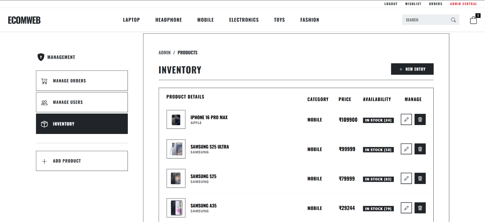
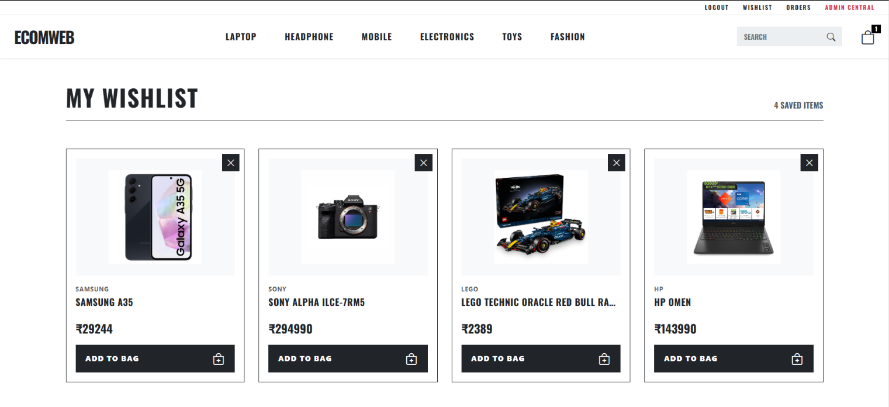

# KLYRO — E-Commerce Platform

KLYRO is a full-stack online store for discovering products, managing a wishlist and cart, and placing and tracking orders. The platform includes customer-facing shopping features and an administration area for managing products, users, and orders.

[Visit the live store](https://ecom-web-vert.vercel.app/)

<p align="center">
  <a href="https://ecom-web-vert.vercel.app/">
    
  </a>
</p>

## Features

- Product discovery with search, categories, filters, sorting, and image galleries
- Customer accounts, wishlists, shopping cart, and order history
- INR checkout with Stripe and cash on delivery
- Product ratings and reviews
- Order and support email notifications
- Admin tools for product inventory, users, and order status
- Responsive layouts for desktop and mobile

## Technology

- **Frontend:** React 18, Vite 7, Bootstrap 5, Axios
- **Backend:** Java 21, Spring Boot 4, Spring Security, Spring Data JPA
- **Database:** MySQL-compatible databases, including TiDB
- **Payments:** Stripe
- **Email:** Brevo transactional email API

## Screenshots

| Storefront | Product management | Admin users |
|---|---|---|
|  |  |  |

| Cart | Wishlist | Checkout |
|---|---|---|
|  |  |  |

## Local development

### Requirements

- Java 21 or later
- Node.js and npm compatible with the installed Vite version
- A MySQL-compatible database

### Backend

1. Create or select a database and make sure its schema is current. Hibernate is configured to validate the schema at startup; it does not create or update tables.
2. Set the backend environment variables:

   - `DB_URL` — JDBC connection URL
   - `DB_USERNAME` and `DB_PASSWORD` — database credentials
   - `JWT_SECRET` — secret used to sign authentication tokens
   - `FRONTEND_URL` — frontend origin, usually `http://localhost:5173` for local development

3. Start the backend:

   ```bash
   cd backend/ecom-proj
   mvn spring-boot:run
   ```

The API runs at `http://localhost:8080`.

### Frontend

1. Install dependencies and start Vite:

   ```bash
   cd frontend/ecom-frontend-5-main
   npm install
   npm run dev
   ```

2. Open `http://localhost:5173`.

The frontend uses `http://localhost:8080/api` by default. To use another backend, set `VITE_API_BASE_URL` to its API base URL, including `/api`.

## Deployment configuration

Configure environment variables in the hosting provider. In addition to the database, JWT, and frontend URL settings above:

- `STRIPE_API_KEY` enables backend Stripe payments.
- `BREVO_API_KEY` and `BREVO_SENDER_EMAIL` enable transactional email. `BREVO_SENDER_NAME` is optional.
- `ADMIN_NOTIFICATION_EMAIL` optionally sets the recipient for administrative notifications.
- The frontend can use `VITE_API_BASE_URL` to select the deployed backend.

Keep credentials in the hosting provider's secret settings. Do not commit API keys or database passwords. Before deploying backend changes, make sure the database schema is up to date; incremental SQL migrations are maintained in `backend/ecom-proj/database`.

## Useful commands

From `frontend/ecom-frontend-5-main`:

```bash
npm run dev
npm run build
npm run preview
```

From `backend/ecom-proj`:

```bash
mvn spring-boot:run
mvn test
```

## Repository layout

```text
backend/ecom-proj/                 Spring Boot API and database migrations
frontend/ecom-frontend-5-main/     React storefront and admin interface
*.png                              Project screenshots
```
